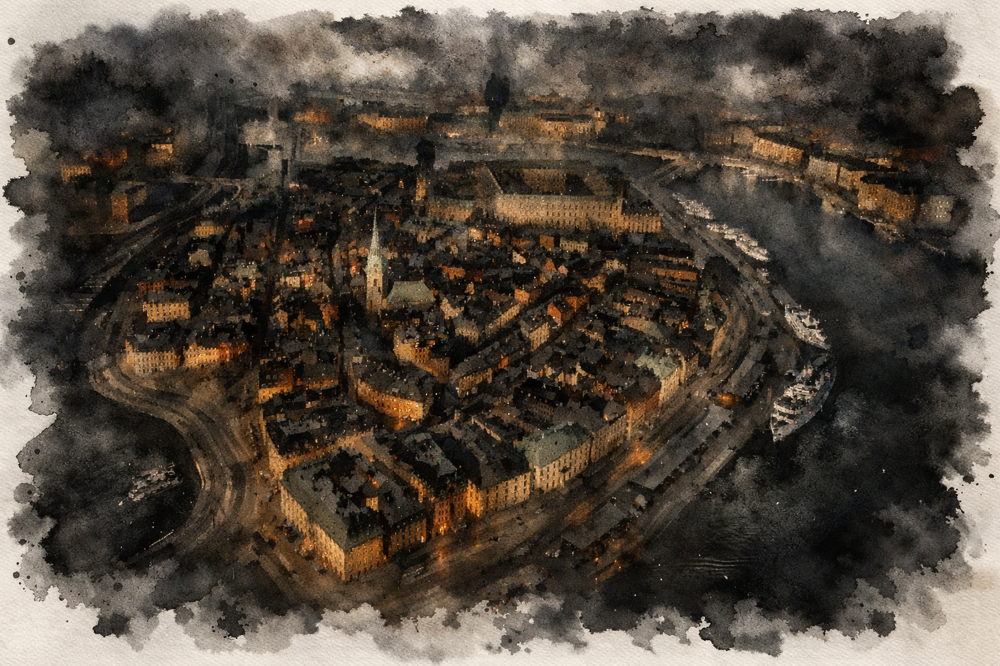

# Vilsna själar – originaldokumentet (arkiv)

> Konverterad från `Vilsna_sjalar.docx` 2026-10-24. **Arkiv, inte kanon.** Texten är oförändrad bortsett från bildlänkar. Det som förts in i repot och det som inte gjort det står i [arbete/fran-originalet.md](../arbete/fran-originalet.md).

---

Vilsna själar

*Ett äventyr till Kult: Den förlorade gudomligheten av Mattias Geisler och Martin Svärd*

En torr och varm sydvind blåser genom Stockholm. Det är oktober och stjärnklart. Meteorologerna talar om luftströmmen från Medelhavet som pressats upp mot nordliga breddgrader.

Men den som lutar åt det konspiratoriska och söker andra förklaringar än de vetenskapliga, anar att något inte står rätt till. Att vinden bär spår av forntida röster och en svag doft av kryddor.

Och att himlen är mörk. Lite för mörk.

Scenariot kretsar kring identitet och utspelar sig i ett höstmörkt Stockholm i nutid.

# Översikt

## Bakgrund

För en tid sedan gjorde professor Herman Abrahamsson ett fynd vid en utgrävning vid Döda havet, där arkeologerna trodde sig ha funnit resterna av Sodom. I ett jordlager med förkolnade byggnadsrester hittade han ett par intakta lertavlor. De var skrivna med kilskrift och innehöll domstolsprotokoll samt en ritual.

Utifrån informationen på lertavlorna drog professorn slutsatsen att ledarskiktet i Sodom hade kommit över ockult kunskap som de började använda. Med hjälp av passionsmagi försökte de bryta sig loss från den fångenskap de ansåg sig leva i. När stadens präster förstod vad som pågick uppstod en maktstrid som slutade med att prästerna dömdes till döden. Hur berättelsen om Sodom slutar framgår inte av lertavlorna, men utifrån de arkeologiska fynden vid utgrävningen och texterna i Bibeln (1 Moseboken 18–19) antar professorn att de ockulta ledarna störtades och att Sodom i samband med det ödelades.

Tillbaka i Stockholm fortsätter professorn att studera den kilskriftstavla som innehåller ritualen. När historiska och arkeologiska metoder inte längre räcker övergår han till att fördjupa sig i ockultism. Det övertygar honom om att ritualen faktiskt har en effekt, även om han inte förstår vilken. Han förstår dock att priset för den som utför den är att minnena går förlorade. Den insikten förändrar honom – i stället för att själv utföra ritualen börjar han planera hur han ska få andra att göra det åt honom.

Parallellt med sin forskning undervisar han kursen ”Forntida civilisationers kultur och samhällsliv”. Fördjupningskursen är kopplad till Stockholms universitet och är en blandning av historia och arkeologi med inslag av ockultism. Det sistnämnda, tillsammans med att undervisningen sker i professorns privata bostad, har gett kursen kultstatus.

När professorn tar emot en ny grupp studenter efter sommarlovet sätter han sin plan i verket. Målet är att få dem att genomföra ritualen och att utnyttja dem efter att de har förlorat sina minnen. Han har förberett det hela genom att endast anta studenter med svaga sociala band, och genom att se till att de alla bor i studentlägenheter nära hans bostad i Gamla stan. När kursen startar låter han dem skriva om sig själva och lämna in texterna i förseglade kuvert – kuvert som han i hemlighet har öppnat och ändrat, och som han planerar att använda när de återvänder från ritualen utan sina minnen.

## Det krossade upproret

Vad som verkligen hände i Levanten för knappt fyratusen år sedan var ett utbrytningsförsök. En grupp upplysta människor – på gränsen till vakna – hade använt magi för att vända sig mot sina fångvaktare. Med stulna artefakter från Maskinstaden höll de upproret dolt tills det nästan var för sent. I sista stund såg Demiurgen dem. Han skickade en väldig här av änglar, ledda av arkonten Netzachs inkarnater. Efter en lång och blodig strid förintades städerna. Inga överlevde.

Ledaren Ishtar dödades tillsammans med de övriga invånarna. Hennes själ skickades till Chokmahs citadell, där den svävade i en svart katedralkammare och tömdes på minnen och begär. Men Ishtar hade förberett sig och bundit sina minnen till ritualer som lät henne stå emot arkontens försök. Hennes hopp stod till att hennes följeslagare, återfödda i nya kroppar, en dag skulle finna lertavlan och fullborda ritualen som där beskrevs – ett öde de tillsammans hade förseglat i en mäktig tids- och rumsritual.

Ishtars mål är att samla sina forna bundsförvanter och fullfölja det uppror som en gång krossades. I äventyrets slut ställs rollpersonerna inför valet att hjälpa henne eller återgå till sina forna liv.

## Hur minnesförlusten fungerar

Äventyret börjar med att rollpersonerna har en partiell minnesförlust. De minns inte vilka de är och kan inte återvinna sina identiteter genom att anstränga sig. De kan känna igen en plats eller ett föremål, men vet inte varför. De kan följa skyltar, läsa kartor och ta sig fram, men inte orientera sig genom minnen.

De vet vad en cykel är, men inte vilken som är deras. Först när de använder något märker de om de behärskar det – och hur väl. De känner inte igen några andra människor, inte ens sig själva.

*Om spelarna försöker kringgå minnesförlusten genom logiska resonemang eller genom att leta efter luckor i äventyret ska du som spelledare avbryta och förklara att det är en återvändsgränd och att det förstör upplevelsen.*

## Rollpersonerna

Scenariot är skrivet för fyra spelare. Till skillnad från andra äventyr får spelarna sina karaktärsbeskrivningar successivt under spelets gång.

- När en rollperson ser sig i en spegel, eller när någon annan beskriver hur hen ser ut, ger spelledaren spelaren karaktärsbladet med tillhörande bild.

- När en spelare slår ett Spelardrag får spelaren sitt Attribut-värde direkt efter slaget, oavsett utfall. (Tålighet, Viljestyrka …)

- När en rollpersons Fördel aktiveras ges den till spelaren före slaget. Om exempelvis något farligt och oväntat inträffar får SÄPO-agenten Fördelen Kyla under stress.

- Spelledaren bör uppmana spelarna att anteckna vad de får veta om sig själva. Under stora delar av äventyret kommer de att få ledtrådar om vilka de är.

Nedan följer en kort beskrivning av rollpersonerna.

### Alexander Ehrson – SÄPO-agenten

Alexander är infiltratör inom Säkerhetspolisen med uppdrag att identifiera och avvärja hot från extremistmiljöer. Spår efter en ockult grupp förde honom till professorn, och han tog sig in på kursen under täckmantel som student. Han deltog i ritualen men planerade att sätta dit professorn efteråt. För professorn uppgav han att han saknade anhöriga och registrerade sig med ett falskt personnummer. Hans riktiga namn är Axel Ehrenborg, och han är av adlig börd. Släktgodset ligger i Uppland. De närmaste vet att han ofta är borta under längre uppdrag och har därför inte börjat leta efter honom när scenariot inleds. Han är i 30-årsåldern.

Som student spelade han nyfiken och frågvis inför det ockulta. Han drev på gruppen att genomföra det professorn föreslog för att snabbare få fram bevis mot honom. Professorn noterade att hans historiska förkunskaper var förvånansvärt bristfälliga.

**Passiva attribut**: Tålighet +1, Viljestyrka +1, Reaktion +2.

**Aktiva attribut**: Intellekt +1, Intuition +0, Sinnen +1, Kyla +3, Hårdhet +2, Utstrålning -1, Själ -2.

**Kyla under stress**

När något farligt och oväntat inträffar behåller du lugnet och uppfattar situationen klarare än andra, **slå +Kyla**:

**(15+)** Du hinner utföra en snabb handling innan andra hinner reagera. Du kan exempelvis undvika en fara riktad mot dig eller rädda någon i din närhet.

**(10–14)** Du hinner utföra en snabb handling, men till en mindre kostnad. Spelledaren anger kostnaden innan du väljer om du vill genomföra handlingen eller inte.

**(–9)** Du missbedömer situationen. Spelledaren gör ett drag.

### Peter Keller – Ockultisten

Peter har sitt sociala liv på nätet, där han är känd under aliaset Obsidian8 och har vänner över hela världen. I det fysiska livet är han tillbakadragen och blyg och lever på studiemedel medan han läser enstaka kurser utan tydlig plan för framtiden. När han var liten försvann hans bästa kompis under oklara omständigheter. Han såg tecken på att något övernaturligt låg bakom, men polisen hävdade motsatsen trots att de saknade bevis och lade till slut ner fallet. Det fick honom att söka svar bortom de etablerade förklaringarna, och med tiden drogs han till gothkulturen och dess fascination för det ockulta. Med The Sisters of Mercy som idoler har han länge fördjupat sig i mörkare tankevärldar. Mörkklädd, lång och smal påminner han om bandets sångare Andrew Eldritch. Intresset för det ockulta fick honom att söka kursen. Han är 28 år gammal.

Professorn var imponerad av Peters kunskaper om det ockulta och kände ett visst mått av ånger när han lät honom förlora sitt minne.

**Passiva attribut**: Tålighet +0, Viljestyrka +2, Reaktion +1.

**Aktiva attribut**: Intellekt +2, Intuition -2, Sinnen +1, Kyla +1, Hårdhet +0, Utstrålning -1, Själ +3.

**Magisk intuition**

Du har en förmåga att känna av magi och uppfatta övernaturliga fenomen som andra förtränger eller undermedvetet bortförklarar. När spelledaren bedömer att din magiska intuition reagerar, **slå +Själ**:

**(15+)** Du uppfattar vad som är magiskt eller övernaturligt och kan koppla det till ockult kunskap du minns.

**(10–14)** Du uppfattar vad som är magiskt eller övernaturligt men saknar kunskap om vad det är.

**(–9)** Du uppfattar något som inte stämmer, men misstolkar det eller drar fel slutsats – eller så märker du inget alls. Spelledaren kan göra ett drag.

### Rebecca Rosenberg – Mångmiljonären

Rebecca har arabiska drag men är judinna från USA. Som spädbarn flyttade hon med sina förmögna föräldrar till Sverige, där hennes far arbetade i ett större företag. Hon talar svenska och engelska som sina modersmål. Efter gymnasiet återvände familjen till New York och hon började arbeta inom familjens verksamhet. I trettioårsåldern drabbades hon av en livskris som väckte hennes intresse för det judiska arvet. Ekonomiskt oberoende och utan behov av att arbeta flyttade hon tillbaka till Sverige och började studera religionshistoria vid Stockholms universitet. Hon sökte fördjupningskursen av nyfikenhet på judisk mysticism och sanningen bakom de forntida berättelserna i Toran. Rebecka är knappt fyrtio år.

Professorn har svårt för hennes överklassattityd och har flera gånger ångrat att han antog henne. Att han indirekt berövade henne hennes minne är något han njuter av.

**Passiva attribut**: Tålighet +1, Viljestyrka +1, Reaktion +1.

**Aktiva attribut**: Intellekt +1, Intuition +2, Sinnen -2, Kyla +0, Hårdhet +1, Utstrålning +2, Själ +0.

**Naturlig ledare**

När du kliver fram och tar kommandot, **slå +Utstrålning**:

**(15+)** Personerna omkring dig accepterar dig som ledare och lyssnar på dig. Du har *+1 pågående* mot dem så länge de accepterar ditt ledarskap.

**(10–14)** Personerna omkring dig lyssnar på dig. Du har *+1 på nästa slag* mot dem.

### **(–9)** Dina försök att ta kommandot väcker motstånd och förakt. Spelledaren gör ett drag. 

### Marie Alm – Akademikern

Maries familj omkom i en frontalkrock med en timmerlastbil, och hon växte därefter upp ensam med sin mormor, Astrid Örn, på Östermalm i Stockholm. Hennes brinnande intresse för det förflutna fick henne att läsa historia och arkeologi vid universitetet. Hennes slutmål är oklart, men hon siktar på att bli museiintendent, arkivarie, arkeolog eller något liknande – och om allt går åt skogen, historielärare. Innan hon flyttade in i studentlägenheten gjorde hon slut med sin pojkvän. Hon hade A i alla kurser på gymnasiet och högsta betyg på samtliga universitetskurser. Hon är perfektionist och lägger ner all sin energi på att lösa varje uppgift så bra som möjligt. Kanske är det därför hon saknar en stor bekantskapskrets. Tatueringen på hennes arm, “2003-02-20”, är datumet då hennes familj dog. Marie är 28 år.

Professorn är i hemlighet förälskad i henne.

**Passiva attribut**: Tålighet +0, Viljestyrka +2, Reaktion +0.

**Aktiva attribut**: Intellekt +3, Intuition +1, Sinnen +0, Kyla -1, Hårdhet -2, Utstrålning +2, Själ +1.

**Expert**

Du är expert inom historia och arkeologi. Dina kunskaper finns kvar trots minnesförlusten och gör sig påminda när de är relevanta. När du **undersöker** något kopplat till dina ämnesområden får du alltid ställa en extra fråga, oavsett utfallet, och du är inte begränsad till frågelistan.

**Hjälplös**

När du ser ut att vara försvarslös och befinner dig i en farlig eller utsatt situation, **slå +Utstrålning**:

**(15+)** Ta två övertag.

**(10–14)** Ta ett övertag.

### **(–9)** Någon försöker utnyttja dig. Spelledaren gör ett drag. 

*Du kan spendera dina övertag under scenen för att:*

\- Få någon att ta hand om dig eller skydda dig.

\- Få en aggressiv person att avstå från att skada dig.

# 

# Akt 1: Förlorade minnen

Scenariot utspelar sig i nutid, i slutet av oktober i Stockholm. En ihärdig sydvind från Medelhavet håller vädret blåsigt, klart och ovanligt varmt.

## Ett bryskt uppvaknande

Rollpersonerna vaknar upp i en fönsterlös källarlokal på universitetet utan minne av vilka de är (se *Hur minnesförlusten fungerar* ovan). Det inrökta rummet är en gammal replokal med mörka tyger längs väggarna, nötta planscher från 90-talsgrupper som Rage Against the Machine, Rammstein och The Cranberries, och ett trumset uppställt intill väggen. Trasmattorna är skjutna åt sidan för ett pentagram målat i ockra och blod. På dammiga hyllor och förstärkare längs väggarna står nedbrunna stumpar av svarta stearinljus. Två tjocka blockljus lyser upp rummet. På en nedsutten soffa vid väggen närmast skyddsrumsdörren ligger rollpersonernas kläder. Intill dörren står en stor, sprucken kroppsspegel.

Rollpersonerna ligger i sina underkläder vid varsin spets av pentagrammet. Det känns som om de har vaknat ur en djup sömn — på deras hud finns tecken och ockulta symboler målade i blod som hunnit torka. En ung kvinna ligger orörlig vid den femte spetsen. Till skillnad från de andra har hon ett bandage runt ena armen. Hon andas inte.

### Vad rollpersonerna kan upptäcka

**Ritualföremål**: Ser rollpersonerna sig om på golvet hittar de en blodig skalpell, två bägare med rester av blod och en zip-lockpåse med ockra, märkt “ockra”. De hittar också ett papper med ritualinstruktioner, men nästan all text är utsuddad — trots att den är skriven med vanlig bläckpenna. Det är Illusionen som, när den åter slöt sig, suddade ut spåren av det övernaturliga. Man kan dock utläsa ord som “ritual”, “Ishtar” och “pentagram med ockra och blod”, samt se tecken som liknar dem de har på sina kroppar.

**Den livlösa kvinnan**: Kroppen visar tydliga tecken på att vara död. Kvinnan är i trettioårsåldern med långt blonderat hår. Under bandaget syns ett djupt snitt från en skalpell. Det finns tecken på att blod har tappats, men inte i någon större mängd. Kvinnan heter Ellen och är en kurskamrat till rollpersonerna — men det vet de ännu inte. På halsen syns spår av ett strypgrepp.

**Spegeln**: Rollpersonerna känner inte igen sina egna ansikten. Ge spelaren bilden av sin rollperson när den ser sig själv i spegeln.

**Kläderna**: Fem klädhögar. Det går inte att avgöra vems som är vems. Damkläderna är i samma storlek, liksom herrkläderna. Mobilerna är avstängda och omöjliga att låsa upp. Nycklarna är identiska och leder till deras hem – kollektivet i Gamla stan. De har inga kreditkort, körkort eller andra legitimationer som kan avslöja vilka de är. All sådan information finns i deras låsta mobiltelefoner.

- Alexander: *Lager-på-lager* med grå t-shirt, röd hoodie och svart field jacket. Vita sneakers och jeans. Mobil. Husnyckel. Visitkort: Professor Herman Abrahamsson, Institutionen för fornarkeologi, Stockholms universitet, Själagårdsgatan 15a, 111 29 Gamla stan.

- Peter: *Rockminimalism* med svarta jeans, t-shirt, sneakers och skinnjacka. Mobil. Husnyckel.

- Rebecca: *Diskret lyx.* Täckväst, mörk kashmirkofta, sidenblus och välskurna byxor. Eleganta boots och en exklusiv men återhållsam handväska. Mobil. Husnyckel.

- Marie: *Akademisk minimalism* med grå ullkappa, mörk stickad tröja och ljus skjorta. Raka byxor och enkla läderkängor. Mobil. Husnyckel.

- Ellen: *Kreativ vintage* med oversized kavaj och polotröja. Vida jeans och röda sneakers.

**Stearinljusen**: Blockljusen har brunnit länge och kan ha varit tända i upp till ett halvt dygn.

### Bandet

Plötsligt sticks en nyckel in i låset. Dörren låses upp. Två killar och två tjejer i tjugoårsåldern kliver in med instrumentfodral över axlarna. De ser ut som vilka studenter som helst. De stannar tvärt när de får syn på rummet. Bandmedlemmarna reagerar med chock och osäkerhet. Om rollpersonerna inte ger dem en trovärdig förklaring är det sannolikt att någon av dem ringer polisen så snart tillfälle ges. En av dem kan också börja filma rummet med sin mobil.

### Universitetsområdet

När rollpersonerna lämnar replokalen kommer de ut på universitetsområdet i Frescati. Skyltar och studenter gör det enkelt att hitta mot tunnelbanan. De förstår hur tunnelbanan fungerar och vet var Gamla stan ligger.

\*start box\*

#### Ritualen

Med spänd entusiasm följde studenterna professor Abrahamssons anteckningar. De tände stearinljus och ritade pentagrammet på golvet med lite av Ellens blod uppblandat med ockra. Därefter drack de vin ur ett kärl de fyndat på en loppmarknad, medan de mässade texter på svenska med instuckna fornhebreiska ord. Ritualen fick deras minnen att frigöras och sippra genom slöjan mot Chokmahs citadell, vilket luckrade upp Illusionen.

Efter en timme börjar replokalen utanför pentagrammet lösas upp. Väggarna bleknar bort och försvinner. Plötsligt står de i en enorm sal i svart sten, likt en katedral med otaliga mörka utgångar, någonstans högt uppe i arkonten Chokmahs citadell.

De börjar kalla på Ishta. Varje gång de uttalar namnet strömmar ett svagt ljus ur deras munnar och letar sig in i någon av citadellets gångar. Ingen av dem märker att deras minnen försvinner med varje anrop. Efter ett tag ser de hur en skinande, eterisk gestalt träder fram från en av utgångarna och kommer skridande emot dem. Den stannar utanför pentagrammet. Ellen reser sig och går fram för att omfamna gestalten.

I samma ögonblick som de rör vid varandra slungas studenterna tillbaka till replokalen, och faller in i medvetslöshet.

\*slut box\*

## Professorn

Herman Abrahamsson är charmig, egocentrerad och manipulativ. Han har sadistiska drag och kan inte låta bli att finna ett visst nöje i att se rollpersonerna fara illa och stå hjälplösa. Han är kunnig och vis, och ser sig därför som mer värd än andra människor. Han är i 60-årsåldern och bor tillsammans med hushållerskan Jelena i en etagelägenhet på Själagårdsgatan 15A i Gamla stan. Huset är ett gårdshus och granne med studentkollektivet (se nedan). Den nedre våningen består av ett enkelt kök, hushållerskans sovrum och ett stort bibliotek där han brukar hålla sina lektioner. På den övre våningen finns hans sovrum och arbetsrum med en samling ockulta böcker. Professorn arbetar hemifrån men lämnar bostaden för kortare promenader eller viktiga ärenden.

När rollpersonerna kommer till honom, välkomnar han in dem i biblioteket. Hushållerskan, en flykting från Serbien, tar fram te och smörgåsar. Han är ivrig att veta hur ritualen gick, men vill samtidigt inte avslöja att han är arkitekten bakom den. När han hör att Ellen dött blir han skärrad. Det var något han inte var beredd på, även om han förstod att det fanns risker att någon kunde råka illa ut. Nu inser han att han själv kan drabbas, eftersom spåren leder till honom.

Professorns mål är att få rollpersonerna att tro att det var de själva som tog initiativet till ritualen och att han, tvärtemot sanningen, försökte avstyra dem. Han vill också försäkra sig om att deras minnesförlust är tillräcklig för att han ska kunna ge dem de brev han har manipulerat.

När rollpersonerna frågar vilka de är berättar han deras namn, men säger att han inte känner dem närmare. Han passar på att berätta om kursen *Forntida civilisationers kultur och samhällsliv* och förklarar att delkursen de arbetade med handlade om mellersta bronsålderns religion i Levanten (ca 2000–1550 f.Kr.), området mellan Egypten och Mesopotamien. Han berättar också att de bor i gårdshuset mittemot.

Om de frågar vem Ishtar var ställer han en motfråga: Hur känner de till henne? Professorn säger att det finns teorier om att hon var en ledargestalt i Sodom. Samtidigt vill han få tillbaka ritualen som han hävdar att de har stulit från honom. Han blir fascinerad av att texten har försvunnit från pappret.

### Breven

Professorn ger rollpersonerna deras brev när han anser att det är lämpligt och är övertygad om att de inte minns något av vilka de en gång var. Han förklarar att det var en uppgift han brukar ge när kursen startar, för att få studenterna att förstå hur de har förändrats när kursen avslutas. De uppmanades att skriva ärligt och personligt om vilka de är. Kuverten är förseglade.

**Alexander Ehrson**

Jag sökte kursen på grund av mitt brinnande intresse för historia och forntiden. Jag är 33 år gammal och singel. Studentboendet passar perfekt, så jag slipper hanka mig fram på andrahandskontrakt. För ett par år sedan skilde jag mig från min fru. Vi fick inga barn. Det blev en stor förändring som fick mig att ifrågasätta mina livsval och slutade med att jag sa upp mig som elektriker och började omskola mig. Vad mitt slutmål är vet jag inte, men jag har några år kvar med studiemedel och tänker ta vara på dem.

*Professorn har inte manipulerat Alexanders brev. Men eftersom det är skrivet utifrån en undercover-identitet är allt i brevet, utom hans ålder, en lögn.*

**Peter Keller**

Jag är 28 år gammal och har hela mitt liv varit fascinerad av det förflutna. Innan jag började utbildningen levde jag i stort sett hela mitt sociala liv på nätet. Det tog många år innan jag förstod att det förstörde mitt liv och min självkänsla – jakten på snabb och positiv feedback från likasinnade var falsk. Nu har jag lagt mitt liv på nätet bakom mig. För alltid. Studentkollektivet ger mig en chans att hitta vänner för livet. Jag har hört mycket gott om professorn, att han är en person man verkligen kan lita på och en av de mest kunniga inom sitt område.

*Professorn har manipulerat Peters brev helt. I själva verket hade Peter skrivit att han beundrade sociala medier och att hans kontaktnät på nätet betydde mycket för honom, samt att han var osäker på hur kompetent professorn egentligen var.*

**Rebecca Rosenberg**

Jag är en medelålders judinna från USA som växte upp i Sverige under skoltiden. Nu har jag sökt mig tillbaka hit för att hitta mig själv igen. Jag behöver en paus från allt arbete i New York och tid för att komma över skilsmässan. Och hitta nya och bättre vänner. Jag känner faktiskt ingen i Stockholm.

Jag sökte kursen eftersom jag är intresserad av ockultism i allmänhet och judisk mysticism i synnerhet. Jag hoppas att vi får ta del av gamla ritualer som vi kan pröva. Även om professorn inte låter oss göra det kommer jag att försöka få de andra deltagarna att göra det ändå.

*Det första stycket är sant. Det andra är manipulerat av professorn för att lägga skulden för ritualen på henne.*

**Marie Aalm**

Jag är en positiv ung kvinna som ser fram emot utbildningen, men jag har en bekännelse att göra. Jag sökte utbildningen för att jag är hopplöst förälskad i professorn. Hans auktoritet och kunnande är något jag faller pladask för, och jag har alltid varit svag för grå tinningars charm. Samtidigt är jag less på alla ungtuppar i min egen ålder. De tror att de förstår hur världen fungerar. Hela tiden tvärsäkra, med enkla förklaringar på komplicerade problem. SUCK. Nej, det är slut med det från och med nu. Hellre en mogen man. Jag har för övrigt hört att han ska vara en fantastisk älskare och innanför skalet en riktig romantiker. Och rik.

Men nu hamnar jag lite snett, märker jag. Jag har haft högsta betyg i allt och kommer att fortsätta ha det under den här utbildningen också. Det kommer inte att ha ändrats när jag läser det här igen.

*Professorn har manipulerat brevet helt för att hon ska falla för honom. Allt är falskt förutom det sista stycket.*

## Studentkollektivet

På Själagårdsgatan 15B bor rollpersonerna, Ellen Melin och My Lindström. De har var sitt rum och delar kök, vardagsrum, dusch och toalett. Professorn låter sina elever bo i kollektivet så länge de studerar under honom. När någon åker ut är det ofta en otrevlig affär.

Gårdshuset är ett tvåvåningshus med två studentrum på nedervåningen och fyra på övervåningen. På nedervåningen finns också en hall med sex garderober, ett mysigt allrum med eldstad vid trappans fot, ett kök med matplats för sex personer och ett badrum. På övervåningen finns ytterligare ett badrum. De gemensamma ytorna är välstädade och hemtrevliga.

### My Lindström

Om rollpersonerna inte kommer in på natten kommer de att träffa My. Hon sitter uppkrupen i soffan framför en brasa och doftljus samt läser en bok. Hon flyttade in i kollektivet för en vecka sedan. Egentligen skulle hon inte komma förrän i mitten av november, men tog sig friheten att flytta in tidigare. Det ställde till problem för professorns planer, som uppmanade de övriga i kollektivet att ta med henne på ritualen. De andra tyckte att det var en dålig idé eftersom de inte litade på henne. I stället kom de överens om att hålla tyst om ritualen.

My har ingen aning om vad som hänt och har inte riktigt lärt sig de andras namn ännu. Hon vill gärna passa in och bli en del av gruppen som verkar stå varandra nära och brinna för sina studier.

**Ledtrådar**: Använd My för att ge ledtrådar om vilka rollpersonerna var före minnesförlusten. Hon kan till exempel ifrågasätta innehållet i breven de skrivit om sig själva, eller påpeka om de inte har sina egna kläder på sig. Hon tjuvlyssnade på dem innan de begav sig av och hörde hur de repeterade fraser på ett främmande språk. Hon hörde också hur de diskuterade vem som skulle ge blod att blanda med ockra – och om ritualen skulle få någon effekt eller inte.

### Studenternas rum

**Alexander Ehrson**: Rummet är opersonligt, nästan som ett hotellrum. På skrivbordet står en dyr bärbar dator, kopplad till en avancerad router och en separat brandvägg. Studentlitteraturen ligger prydligt staplad bredvid och ser nästan oläst ut. I ett hörn står tyngder och en träningsbänk. I garderoben hänger en skräddarsydd kostym bredvid vardagskläder och exklusiva träningsplagg. Datorn är krypterad och kräver rätt lösenord. Alexanders tjänstepistol, en Glock 17, är gömd någonstans i rummet.

**Peter Keller**: På ena väggen hänger en inramad affisch med The Sisters of Mercy. På skrivbordet står en stor gamingdator och framför den en matchande stol. Kläderna i garderoben går i svart. Datorn är låst och kräver rätt lösenord.

**Rebecca Rosenberg**: Rummet är ombonat med rökelser, blommor, olika lampor och röda gardiner. Den bärbara datorn på skrivbordet är låst och kräver rätt lösenord. Förutom studentlitteraturen finns en rad magasin om företagande, aktier och omvärldsanalyser. Allt är på engelska, utom en Torah på hebreiska som ligger vid sängen. När hon öppnar boken märker hon att hon kan läsa hebreiska. I garderoben hänger diskreta, lyxiga plagg i business casual-stil.

**Marie Alm**: Rummet är rörigt, med kläder i högar på stolar. Klädstilen är enkel och funktionell, i dämpade färger. En bärbar dator ligger i sängen med laddaren inkopplad i vägguttaget (kräver lösenord). Hyllorna ovanför skrivbordet är fulla av böcker om arkeologi och historia, markerade med överstrykningar och täta marginalanteckningar med hänvisningar till andra verk. När hon bläddrar i böckerna märker hon att hon behärskar ämnena väl. Ge henne fördelen ***expert***. Garderoben är nästan tom.

**Ellen Medin**: Rummet är helt fritt från spår av Ellen. Hennes tillhörigheter är borta. Med tiden kommer rummet att förändras. Forntida dekorationer börjar framträda: reliefer på väggarna, krukor och små figurer. Väggarna färgas långsamt brunröda.

**My Lindström**: Hon har ännu inte hunnit komma i ordning. En flyttkartong med böcker och prylar står fortfarande framme. En elgitarr lutar mot väggen bredvid en förstärkare. Den gick nyligen sönder. Om My får reda på att Alexander har ett förflutet som elektriker ber hon honom titta på vad som kan vara fel. Han upptäcker då att han inte kan någonting om elektronik.

## Polisen 

Polisen får snart kännedom om Ellens döda kropp i replokalen. De har konstaterat att lokalen bokats av en Ellen Medin, men ännu inte förstått att det är hon som hittats död. Genom hennes namn har de fått fram att hennes folkbokföringsadress är på Själagårdsgatan 15B. De åker dit för att förhöra henne och söka igenom hennes rum. De har med sig ett beslut om husrannsakan.

*“Vi har hittat en kvinna död i en lokal som bokats i det här namnet. Vi försöker bara reda ut vad som hänt.”*

De söker först igenom Ellens rum. Det som tidigare varit tomt rymmer nu tre stiliserade terrakottafigurer. De föreställer tre sammanflätade kvinnokroppar. Poliserna ser dem som märkliga prydnadsföremål, men rollpersonerna tycker sig känna igen dem som fertilitetsfigurer från bronsålderns Levanten. Symbolerna som täcker figurerna liknar dem rollpersonerna vaknade med. Poliserna fotograferar figurerna och konstaterar att symbolerna påminner om dem som fanns på kroppen i replokalen.

De ber att få se legitimation av samtliga närvarande. Eftersom endast My Lindström kan uppvisa giltig legitimation beslutar poliserna att hålla två separata förhör. Först förhörs My i sitt rum på övervåningen. Därefter samlas rollpersonerna till ett gemensamt förhör. Poliserna antecknar allt och fotograferar dem.

Grundläggande frågor:

- Vad heter ni?

- Personnummer?

- Hur länge har ni bott här?

- Beskriv din relation med Ellen Medin.

- När såg ni henne senast?

Om de misstänker koppling till replokalen:

- Var befann ni er i går kväll, och vem kan styrka det?

Om figurerna:

- Vet ni vad de här föreställer?

- Känner ni igen de här tecknen?

Om signalement finns blir tonen skarpare:

- Har ni träffat ett band i Frescati nyligen?

- Varför stämmer ert utseende med deras beskrivning?

Det är svårt för rollpersonerna att ljuga sig ur situationen. Deras minnesförlust väcker misstankar och försvagar deras trovärdighet. Poliserna ber om frivilligt DNA-prov innan de lämnar adressen. Rollpersonerna är tydligt misstänkta.

# Akt 2: Kollektivet på Själagårdsgatan

Akten är öppen. Ledtrådar om rollpersonernas identitet vävs samman med aktörer med egna agendor. Scenerna presenteras utan inbördes ordning och aktiveras utifrån rollpersonernas handlingar. Vissa aktörer är kopplade till en nedräkning, där deras handlingar beskrivs i stegrande ordning.

## Ritualens bakgrund

Det är troligt att rollpersonerna försöker ta reda på om kursen de läser har en koppling till ritualen som stal deras minnen. Det är också sannolikt att professorn vill undersöka hur mycket de minns genom att förhöra dem om kurslitteraturen. Som tidigare nämnts minns de inte vad de gjorde under kursen utan hjälp, men om de får veta det från en extern källa återkommer deras kunskap. Följande tillvägagångssätt är mest tänkbara:

- Professorn kallar dem till sitt bibliotek, där blyertspennor och provpapper väntar. De ska skriva var sin uppsats på minst åtta sidor om olika teorier kring Sodom och Gomorra.

- Maria, Rebecca eller Peter ***undersöker*** kurslitteraturen i sina rum.

- Rollpersonerna tar sig in i professorns arbetsrum och ***undersöker*** hans skrivbord, men eftersom professorn nästan alltid är hemma måste han överlistas för att detta ska lyckas.

När rollpersonerna dragit slutsatsen att de arbetade med olika teorier om Sodom och Gomorra, minns Marie, Peter och Rebecca omfattande fakta om Levanten under mellanbronsåldern och teorierna kring städerna och deras undergång. Alexander minns däremot nästan ingenting, vilket helt enkelt beror på att han varken läste igenom kurslitteraturen eller lyssnade på professorns torra föreläsningar:

*Enligt Bibeln beslutar Gud att förgöra städerna Sodom och Gomorra eftersom deras invånare lever i grov synd och ondska. Städerna beskrivs som platser där gränser upplösts, där våld, övergrepp och sexuella excesser blivit norm. Abraham ber Gud skona dem om det finns rättfärdiga människor där, och Gud lovar att göra det om tillräckligt många kan hittas – men så är inte fallet.*

*Två människolika änglar sänds till Sodom och tas emot av Lot, Abrahams brorson. Stadens män samlas utanför huset och kräver att gästerna ska utlämnas så att de kan våldta dem. När de försöker bryta sig in slår änglarna dem med blindhet och uppmanar Lot att fly med sin familj innan staden förstörs. Lot och hans döttrar undkommer när Gud låter eld och svavel regna över städerna.*

*Utifrån arkeologiska fynd drar forskare en annan slutsats om vad som kan ha hänt. Städerna leddes av ett prästerskap som splittrades i en inbördes konflikt. Den ena fraktionen förespråkade en monoteistisk tro, medan den andra förlitade sig mindre på gudomlig auktoritet och använde i stället ockulta ritualer som maktmedel. De förstnämnda förvisades och sökte skydd hos semitiska nomader. Därefter tycks ritualerna i Sodom och Gomorra ha blivit alltmer extrema och perversa, samtidigt som gudstron nästan försvann helt, vilket gav städerna allt fler fiender. Till slut intogs de. Ledaren Ishtar återfanns dock aldrig bland de döda. Städerna brändes sedan ner till grunden.*

## Nedräkning Polisutredningen

De två första stegen inträffar under akt 1. Det sista under akt 3.

7.  Polisen undersöker replokalen, förhör eventuella vittnen och misstänker att ett mord har begåtts. Genom lokalens bokningssystem hittar de Ellens namn och åker dit.

8.  Två poliser åker till studentkollektivet med beslut om husrannsakan i Ellens rum och förhör de som bor där. De hittar tre terrakottafigurer i Ellens rum.

9.  My visar nyheterna på sin mobil: ”Ritualmord på campus”. Eventuellt sprids filmen som bandet tagit på rollpersonerna på nätet.

10. Fyra poliser återvänder till studentkollektivet med beslut om husrannsakan som även gäller rollpersonerna. Om de inte frivilligt har lämnat DNA-prov tvingas de testas. När de öppnar Ellens garderob överraskas de av en handfull grönglänsande spyflugor, stora som gråsparvar. Flugorna flyger ut i kollektivet med ett tungt brummande och sätter sig i hår och ansikten, där de med sina sugsnablar söker efter tårvätska, saliv och slem.

11. DNA-analysen gör att SÄPO inser att en av deras egna är bland de misstänkta. En undercoveragent från SÄPO söker upp studenterna och talar med Alexander, som får reda på sin sanna identitet. Han får order att fortsätta sitt uppdrag, men förstår nu vem han är. Agenten berättar också att rollpersonerna kan häktas när som helst eftersom deras DNA har påträffats på Ellen.

12. Sken från ficklampor sveper över den mörka gårdsplanen. Springande steg och korta rop ekar mellan husväggarna. Hundförarna släpper sina polishundar. Polisen har kommit för att häkta rollpersonerna. (Sker efter Nedräkning Ishtars återkomst, punkt 5.)

## Nedräkning Ishtars återkomst

6.  Ritualen genomförs.

7.  Tre stiliserade terrakottafigurer materialiseras i Ellens rum (sammanfaller med Nedräkning Polisutredningen, punkt 2).

8.  De ovanligt varma vindarna för med sig sand och damm som ställer till problem för parkerade fordon, balkonger och personer med känsliga luftvägar. Meteorologer fascineras av fenomenet och hävdar att stoftet kommer från öknarna kring östra Medelhavet. Morgonsofforna fylls av proffstyckare, förståsigpåare och miljöalarmister.

9.  Onaturligt stora spyflugor upptäcks i Ellens garderob (sammanfaller med Nedräkning Polisutredningen, punkt 5).

10. Mitt i natten hörs ett kraftigt brak från Ellens rum. Dörrkarmen hänger snett och puts har rasat från taket. I hennes garderob har golvet spruckit upp och blottat en mörk nedgång med rostiga steghantag. Upptäckten inleder akt 3.

## Professorn i den andra akten 

I den andra akten är hans mål att förstå vilken effekt ritualen haft och undvika att bli misstänkt för mordet på Ellen. Han försöker också manipulera Marie Alm till att bli hans älskarinna. Följande saker kan han exempelvis göra:

- Spionera på rollpersonerna i kollektivet genom att gå dit själv med något ovidkommande ärende, eller låta hushållerskan spionera samtidigt som hon städar kollektivets allmänna utrymmen. Får hushållerskan möjlighet smyger hon in i deras rum och letar bland deras privata tillhörigheter.

- Bege sig till bårhuset och undersöka Ellens kropp. Informationen kan han dela med rollpersonerna som förevändning för att besöka kollektivet och se hur de reagerar.

- Kontakta polisen och lämna uppgifter som riktar misstankarna mot rollpersonerna. Polisen kommer att använda dem vid senare förhör. När det gäller Rebecca är han mycket specifik: hon är överdrivet intresserad av ritualer och ockultism, har vid flera tillfällen försökt övertala de andra att delta och det luktar ofta cannabis om henne – allt är falskt.

- Genomföra ett prov med rollpersonerna i biblioteket för att förstå hur deras minnesförlust fungerar. (Se Ritualens bakgrund.)

- Kallar Marie till sitt privata rum. Där påstår han att de före minnesförlusten var älskare och att det var hon som tog initiativet. Nu undrar han om hon vill fortsätta vara hans älskarinna. Han hävdar bestämt att hennes minnen kommer tillbaka om de återupptar relationen. Enligt honom beror det på att de religiösa ledarna i Sodom praktiserade passionsmagi och låste minnen som bara kunde öppnas genom en rituell form av passion. Bara professorn påstår sig känna till hur sådana minnen låses upp. Som ett par skulle hon dessutom slippa betala hyran. Allt utom hyran är lögn.

Att **undersöka** professorns rum tar flera timmar. De måste gå igenom lösa anteckningar, läsa delar av ockulta böcker och ta sig igenom hans dator för att förstå vad som hänt. När de är klara förstår de att det är han som fått dem att utföra ritualen, och att han gjorde det trots att han förstod att de skulle drabbas av minnesförlust. De förstår också att han manipulerat deras personliga brev. Information om vilka de är och vilka personnummer de har finns inte. Om rollpersonerna slår 10–14 utsätts de för fara eller andra komplikationer, exempelvis att de måste ta sig till bårhuset och studera de ockulta symbolerna på Ellens kropp.

# Akt 3: Ishtars återkomst

Akten inleds med att rollpersonerna hittar öppningen i Ellens rum. Bestämmer de sig för att inte undersöka nedgången dröjer det inte många timmar innan polisen kommer för att häkta dem. När de ser poliserna och hundpatruller positionera sig runt fastigheten har de en sista chans att fly ned genom gången i Ellens rum. Avstår de, grips de av polisen. Marie, Peter och Rebecca döms till långa fängelsestraff. Alexander, eller Axel som han egentligen heter, undgår åtal men mister sin tjänst på SÄPO. Med åren växer deras nya självbilder fram, präglade av såväl minnesförlusten som det mörker som kommer av den gnagande undran om de mördade Ellen eller inte.

## Den underjordiska gången

En rostig, väggfast stege leder ner i en kall och fuktig stengång som löper söderut. Konstruktionen påminner om en medeltida kloak, med partier där branta trappor fortsätter nedåt. Luften är stillastående och död, som om ingen har andats den på länge.

Efter ett tag känns huvudet tungt och ögonen får allt svårare att hålla fokus. Det blir allt svårare att inte hamna i ett märkligt dubbelseende. Det är som om två saker visas samtidigt och hjärnan har svårt att avgöra vilken bild som stämmer.

Den ena är stengången, som nu har trappor som då och då leder uppåt. Den andra är en förfallen fabriksgång med liggande balkar att ta sig över, rostiga kedjor och vassa spikar som river upp hud och kläder.

Båda vägarna är verkliga samtidigt. Rollpersonerna måste se upp för de branta trapporna samtidigt som de undviker farorna från fabriken. Eventuella förföljare tvingas stanna och vända tillbaka. Deras sinnen klarar inte av att se Illusionen brytas upp och uppfattar vägen framåt som en ogenomtränglig vägg.

## Södersjukhusets kulvert 

Stengången slutar vid en dörr som leder till kulvertarna under Södersjukhuset. Gångarna bildar en egen värld där det är lätt att gå vilse. Skyltar pekar mot förråd, steriliseringsavdelning, tvätteri och andra enheter kopplade till sjukhuset – däribland bårhuset. Om rollpersonerna lämnar kulverten försvinner dubbelseendet och de börjar sakta glida ur Metropolis. När de märker vad som händer har de fortfarande tid att ändra sig och vända tillbaka till kulverten.

I kulverten öppnar sig den svarta natthimlen i Metropolis. De befinner sig plötsligt hundratals meter över marken. För att ta sig fram måste de passera väggfria partier, gå över osäkra, sönderrostade galler och till och med hoppa över stup. Eftersom rollpersonerna samtidigt går genom kulverten kan de behöva hoppa över stup i Metropolis för att komma vidare i Elysium. Långt framme ser de en katedralliknande byggnad, sammanfogad med väggen i ett enormt citadell. De känner en stark dragningskraft dit. När de når den träder de samtidigt in i bårhuset i Elysium.

De anställda har svårt att uppfatta rollpersonerna. De flesta ser dem, men reagerar inte på deras närvaro. Om någon tilltalas rycker personen till av förvåning och undrar hur de kunde stå där utan att ha lagt märke till dem.

Vid det här laget borde det stå klart för rollpersonerna att Ellens lik på något sätt är nyckeln till mysteriet, och att de måste ta sig dit.

Innan de når bårhuset möter de en liktor – 2,5 meter lång, groteskt fet, med mjölkvita ögon och halvgenomskinlig hud. För ett ögonblick skymtar också en gestalt i uniform – en polis. Han har känt att något är fel och tagit sig ner i Södersjukhusets kulvertar. När rollpersonerna ser hans sanna form måste de **visa självkontroll** för att inte drabbas av panik. Korridorerna anpassar sig efter hans storlek när han rör sig genom dem. Han är en farlig motståndare som förstår att rollpersonerna måste stoppas. Rollpersonerna kan försöka överlista honom i de labyrintliknande gångarna eller möta honom i strid. Den som springer genom kulverten springer samtidigt i Metropolis och kan behöva **agera under hot** för att inte skada sig där.

### Liktorn

Förmågor

- Gigantisk: Går inte att hålla fast eller knuffa omkull. Närstridsattacker som träffar får alltid offret att flyga omkull.

- Monstruös: **Visa självkontroll** eller drabbas av panik.

- Tålig: All **skada** liktorn tar reduceras med **1**.

Strid

- Tåla allvarliga skador.

- Låtsas vara död.

**Attacker**

Han kommer att försöka stoppa rollpersonerna med våld, men kommer att fly eller spela död om han blir allvarligt skadad. Han tänker inte riskera sitt liv för detta. Eftersom rollpersonerna är till hälften i Metropolis kan han inte påverka rollpersonerna genom att forma om Illusionen.

Obeväpnad: Slå \[2\] \[Avstånd: arm, offret kastas genom luften\]; Greppa \[1\] \[Avstånd: arm, offret måste **agera under hot** för att komma loss\].

Skador: OOO OOO X

## Bårhuset och Ishtars fängelse

Om rollpersonerna lyckas ta sig till bårhuset vågar inte liktorn följa efter dem. Han känner Ishtars närvaro och vill inte riskera att konfrontera henne.

Den isolerade ståldörren till bårhuset öppnas samtidigt som en katedralport i Metropolis. Det nedkylda bårhuset är klätt i vitt kakel med blodspår på golvet. Bakom en glasvägg syns en obducent som obducerar ett lik. Katedralsalen är byggd av svartglänsande vulkansten. Längs väggarna står rökelsekar vars doft blandas med bårhusets svaga liklukt. I golvet är ett stort pentagram urgröpt i obsidianen. Där står britsen med Ellens lik, täckt av ett vitt lakan. I Metropolis, på samma plats i katedralsalen, står den eteriska Ishtar fängslad i pentagrammet och möter rollpersonerna när de stiger in. Hennes långa, smala gestalt skimrar i ett kallt blåvitt sken. Hennes ansikte är skarpt tecknat, med höga kindben och mörka ögon som vilar på rollpersonerna. Hon börjar tala gammaltestamentlig hebreiska, ett språk de förstår och plötsligt inser att de själva också kan tala som om det vore deras modersmål.

---

## Utkastfragment

*Finns bara i dokumentets första, äldre halva.*

Ja! Slutet är försvunnet!!!

“Sdfg

Änglarna, i form av judiska underrättelseagenter, letar efter Ellen.

### Kollektivet

I gamla stan, på Själagårdsgatan 15, ligger ett gårdshus, det är här det kollektiv som rollpersonerna, professor Abrahamsson, Ellen och My Glans bor i. Det är en vindsvåning i etage som professorn ärvt. Den obehagliga sanningen är att gränsen mellan kollektiv och sekt är nära här. Professorn låter sina favoritelever bo i kollektivet så länge som de studerar under honom. När någon åker ut är det en otrevlig affär.

Entre

Det är en gedigen säkerhetsdörr, uppenbarligen ny, den passar inte in mot trapphusets gamla nötta steg i sten. På dörren finns en mässingsplakett, Abrahamsson. En långsmal hall med dörrar längs med ena sidan och garderober på vänster hand, städat prydligt. Dörrarna är stängda och korridoren slutar i en öppning mot ett stort rum med en trappa som leder upp. Ett fladdrande sken från en brasa och ett tiotal ljus i olika storlekar lyser upp rummet. En inbjudande soffgrupp för säkert tio personer finns mitt i rummet framför eldstaden. En ung person med blond hår sitter uppkrupen i en fåtölj med ryggen mot er och läser, det luktar av och doftljus.

I fåtöljen sitter My Glansvik den senaste personen att flytta in i kollektivet. Hon var inte medbjuden till ritualen då rollpersonerna inte ännu kände sig trygga nog med henne för att anförtro sig till.

My har ingen aning om vad som hänt. Hon har bott i kollektivet i mindre än en vecka och har inte riktigt lärt sig alla andras namn ännu. Hon vill dock väldigt gärna passa in och bli en del av gruppen. Hennes förståelse är att de är mycket nära varandra och att studier och fritid blandas ihop. En grej har irriterat henne lite även om hon är beredd att acceptera det, och det är att hon uppenbarligen har mycket större städområde än de övriga.

På nedervåningen bor studenterna och där uppe är professorns våning. Den består av hans sovrum, arbetsrum och ett stort bibliotek. Det är i biblioteket Abrahamsson håller sina lektioner.

Professor Abrahamsson har en vag aning om att rollpersonernas minnen kan vara luddiga, den totala minnesförlusten är även för honom en överraskning. I första hand vill han veta vad som hänt, han vill dock inte avslöja att han är arkitekten bakom ritualen. Han var absolut inte beredd på att någon skulle dö vilket verkar som Ellen har gjort. Detta skärrar honom mycket, han inser att det finns en risk att han kan råka illa ut. Så att få rollpersonerna att dels ge honom ritualen, som har försvunnit samt att få dem att tänka att de själva kommit på detta, är prioriteter för Abrahamsson.

Med tiden tar dock en plan form,

Karktärerna rum

Eftersom professorn misstänkte en del minnesförlust har han tömt rollpersonernas, samt Ellens rum i kollektivet på personliga saker. Hans ide är att om de inte har vet riktigt vilka de är kan han kontrollera dem bättre för att uppnå sina syften. My är lite osäker på vem som bor var, hon är ju ny. Men följande ledtrådar kan hittas i rummen.

### Att tänka på

- Vad ska hända här?

- Vad säger My?

- Har en av karaktärerna bett my låsa in köksknivarna? Varför?

- Vad säger professorn, vad vill han, hur agerar han?

- Vad sägs om ett besök från polisen

- Ellen kommer tillbaka
