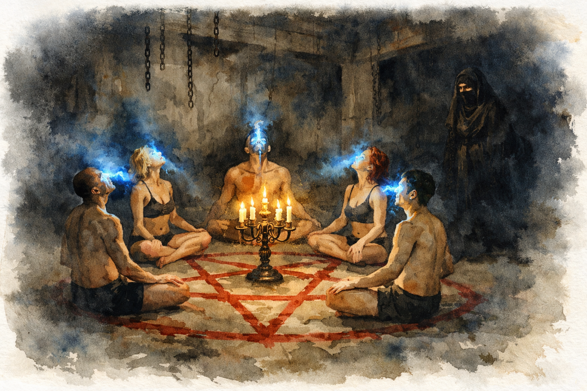

# Sanningen

## Det krossade upproret

För knappt fyra tusen år sedan försökte [Ishtar](../personer/ishtar.md) och stadens aristokratiska elit i Sodom och Gomorra bryta sig ur Illusionen. De var upplysta människor, på gränsen till vakna, som använde magi för att vända sig mot sina fångvaktare. Med stulna artefakter från Maskinstaden höll de upproret dolt tills det nästan var för sent.

I sista stund såg Demiurgen tjänare upprorsförsöket. En väldig här av änglar skickades till städerna. Mitt under den blodiga striden, när allt stod och vägde, tog fyra av Ishtars närmaste sig ut ur Sodom och förhandlade till sig personlig frihet mot att förråda Ishtar. Deras kroppar var aristokraters, och de var Ishtars följeslagare. Änglarna gick med på affären och vann därefter slaget. Städerna förintades och ingen utom förrädarna överlevde. **Förrädarnas själar är rollpersonernas själar.**

Ishtar dödades tillsammans med de övriga invånarna. Hennes kropp bevarades som en mumie, och hennes själ skickades till [Chokmahs citadell](../platser/chokmahs-citadell.md), där den svävade i en svart katedralkammare och skulle tömmas på minnen. Men Ishtar hade förberett sig. Hon hade bundit sina minnen till ritualer som lät henne stå emot arkontens försök. Hon gömde också lertavlorna som ritualen står på, och hennes hopp stod till att någon en dag skulle finna dem och fullborda den.

**Rollpersonerna är förrädarna.** De återföddes i nya kroppar och minns ingenting av detta. Det är en dold sanning från deras nutida skuld. Den kommer i dagen i [manusscenen i Sodom](../scener/sodom-manusscen.md).

## Abrahamssons fynd och plan

För några år sedan gjorde professor [Herman Abrahamsson](../personer/herman-abrahamsson.md) och [Marie](../personer/marie-alm.md) en utgrävning vid Döda havet, där arkeologerna trodde sig ha funnit resterna av Sodom. De hittade en kammare med två lertavlor och Ishtars mumie. Fynden smugglades hem till Stockholm, och det blev början på kulten. Lertavlorna och mumien finns nu i kulthallen i Templet. Offentligt är det Abrahamsson som gjorde fynden, men de största upptäckterna var Maries.

Abrahamsson drog slutsatsen att Sodoms ledarskikt hade kommit över ockult kunskap och försökt bryta sig loss med hjälp av passionsmagi. Han tror att den kristna guden krossade upproret, och känner inte till Demiurgen alls. Kulten bygger på hans tolkning: Ishtar som en uråldrig gudinna som kan ge makt och upplysning.

Det han drömmer om, en fången kvinna i ett svart citadell, är minnen som läcker igenom Illusionen. Han tror att drömmarna är vanliga drömmar. Samma bild återkommer hos [Lukas](../personer/lukas.md).

## Planen som verkligen gällde

Ett par månader före äventyrets start gjorde kulten en olaglig utgrävning i Levanten på egen hand. Där hittades en tredje lertavla, som nu står i biblioteket för intensiva studier. Marie fick ihop bitarna från tavlorna: hon förstod hur ritualen kunde byggas.

Tillsammans med [Peter](../personer/peter-keller.md) började hon lista ut hur en riktig ritual skulle se ut. De ogillade Abrahamsson och ville inte ta med honom i planerna. Samtidigt växte en kärleksrelation fram mellan Peter och Marie. [Rebecca](../personer/rebecca-rosenberg.md) passade deras plan, eftersom pengar alltid är bra. [Alexander](../personer/alexander-ehrson.md) blev den fjärde i gruppen. Han verkade villig och ivrig, och ritualen behövde fyra personer. Hans egen avsikt var att få fram bevis för att sätta dit kulten.

De talade om för professorn att den sanna ritualen kräver ett blodsoffer. Han svarade genom att låta [Jelena](../personer/jelena.md) rekrytera [Viktor](../personer/viktor.md) och [Ellen](../personer/ellen.md), ett knarkarpar från gatan. Han menade blod, men Marie och Rebecca tog det till döden. De började sedan ta till sig Ellen för att ha henne som offer.

## Ritualen

De fyra rollpersonerna följde Maries och Peters plan. I en öde industrilokal i Gränslandet tände de stearinljus och ritade pentagrammet på golvet med Ellens blod uppblandat med ockra. De drack vin och blod ur ett kärl de fyndat på en loppmarknad och mässade texter på fornhebreiska.

Ellen var nerdrogad och trodde att de skulle göra en gemensam ritual. Mitt i ritualen stack de sina dolkar i hennes bröst. Men bara tre av dem fullföljde mordet, och ritualen tog en oväntad vändning. I stället för att stjäla Ishtars kraft frigjorde den henne. Ishtar tog plats i Ellens döda kropp och läker den med sina krafter. Ellen kommer aldrig tillbaka. Det som vaknar är Ellens kropp med Ishtars själ, och blandade minnen från Ishtar, Ellen och rollpersonerna.

Ritualen krävde så mycket kraft att rollpersonernas minnen konsumerades. Minnen är kraftiga magiska energier. Efter en timme började rummet utanför pentagrammet lösas upp. Väggarna bleknade bort, och plötsligt stod de i en enorm sal i svart sten, lik en katedral med otaliga mörka utgångar, högt uppe i citadellet.

De kallade på Ishtar. Varje gång de uttalade namnet strömmade ett svagt ljus ur deras munnar och letade sig in i någon av citadellets gångar. Varje anrop slukade mer av deras minnen.

### Mordet

Rollpersonerna utförde **medvetet ett bestialiskt ockult mord** på [Ellen](../personer/ellen.md), som var [Viktors](../personer/viktor.md) flickvän. De ville tillägna sig vad de trodde var en gudinnas kraft. I själva verket frigjorde de Ishtar ur hennes fängelse. **Ellens själ är nu fången i Ishtars kropp i Chokmahs citadell.** Döden i sig var nyckeln till vägen in i citadellet.

Ellen är nerdrogad och har tre dolkhugg genom bröstkorgen. Hur mordet gick till, hur många som höll i dolkarna och hur många högg, är inte fastställt. Det får spelet och spelledaren avgöra. Någon av rollpersonerna deltog i ritualen utan att vara med i mordet, av skäl som hänger ihop med hens själ. Det är en del av varför ritualen gick som den gick. Alla vaknar lika nakna, blodiga och minneslösa, med dolken på golvet och ingen annan i rummet.

### Efteråt

Rollpersonerna vaknar utan självbiografiska minnen i [ritualkammaren](../platser/ritualkammaren.md), som nu ligger i [Gränslandet](../platser/granslandet.md), ett mardrömslikt område mellan Elysium och Metropolis. När de lämnat kammaren kan de aldrig finna vägen tillbaka. Ingen i [Templet](../platser/templet.md) vet vad de har gjort, inte ens rollpersonerna själva.

Ellens döda kropp ligger kvar i ritualkammaren, och Ishtar bygger den långsamt uppifrån. Ritualtexten de hade med sig är nästan helt utsuddad: när Illusionen slöt sig igen suddade den ut spåren av det övernaturliga.

De vaknar efter ca sex timmar medvetslösa, och Ellens kropp är kall. De tar sig ut i Gränslandet, irrar några timmar och är tillbaka i Templet ca tjugo timmar efter ritualen. De gav sig av på natten och kom tillbaka kvällen efter.

När Abrahamsson får höra att Ellen är död blir han skärrad. Det var inte det han menade med blodet, och nu inser han att spåren leder till honom.

## Ishtars mål

Ishtar vill samla sina forna bundsförvanter och fullfölja det uppror som en gång krossades. Hon kan vakna när hon har återbyggt kroppen. I äventyrets slut ställs rollpersonerna inför valet att hjälpa henne eller återgå till sina forna liv.

## Öppna frågor

- Hur lång tid tar det för Ishtar att läka Ellens kropp? Tiden är inte satt.
- Steffe: kan han dyka upp igen i akt 3, och kanske ta Ellen till myndigheterna?

Besvarade frågor, som vem som deltog i mordet och hur det gick till, finns i [oppna-fragor](../arbete/oppna-fragor.md).

Se även [arbete/oppna-fragor.md](../arbete/oppna-fragor.md).
