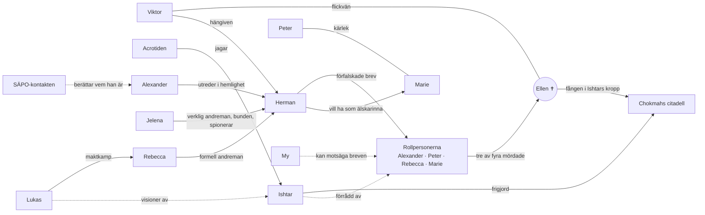

# Personerna

Fyra rollpersoner och sex spelledarpersoner i kulten, totalt tio kultmedlemmar inklusive Ellen. Därtill personer och väsen utanför kulten.

## Rollpersoner

| | Rollperson | Ålder | Fördelar |
|---|---|---|---|
|  | [Alexander Ehrson / Axel Ehrenborg](alexander-ehrson.md) – SÄPO-agenten | 33 | Kyla under stress |
|  | [Peter Keller](peter-keller.md) – Ockultisten | 28 | Magisk intuition |
|  | [Rebecca Rosenberg](rebecca-rosenberg.md) – Mångmiljonären | knappt 40 | Naturlig ledare |
|  | [Marie Alm](marie-alm.md) – Akademikern | 28 | Expert, Hjälplös |

## Spelledarpersoner i kulten

- [Herman Abrahamsson](herman-abrahamsson.md) – professor och kultledare
- [Ellen Medin](ellen.md) – mördad; själen fången i citadellet
- [Viktor](viktor.md) – Ellens pojkvän
- [Jelena](jelena.md) – verklig andreman, flykting från Serbien; en Azghoul bunden till Abrahamsson
- [My Lindström](my.md) – ny medlem, inte med på ritualen
- [Lukas](lukas.md) – egoistisk konstnär med visioner av Ishtar

## Utanför kulten

- [SÄPO-kontakten](sapo-kontakten.md) – Alexanders kollega
- [Astrid Örn](astrid-orn.md) – Maries mormor

## I Gränslandet

- [Steffe](steffe.md) – uteliggare
- [Knarkaren](knarkaren.md) – vilsen kvinna, namn ej bestämt

## Väsen

- [Ishtar](ishtar.md) – frigjord gudinna
- [Acrotiden](acrotiden.md) – skuggan från citadellet
- [Nachtkäfer](nachtkafer.md) – kackerlackslika varelser i Gränslandet

## Relationskarta

