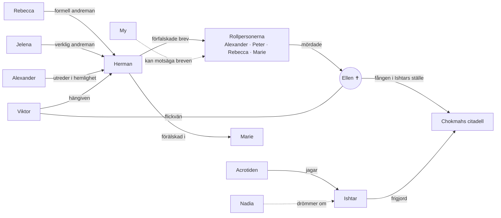

# Personerna

Fyra rollpersoner och sju spelledarpersoner, totalt elva kultmedlemmar inklusive Ellen. Därtill två övernaturliga väsen.

## Rollpersoner

- [Alexander Ehrson / Axel Ehrenborg](alexander-ehrson.md) – SÄPO-agent under täckmantel
- [Peter Keller](peter-keller.md) – ockultist som söker sin försvunna barndomsvän
- [Rebecca Rosenberg](rebecca-rosenberg.md) – finansiär och formell andreman
- [Marie Alm](marie-alm.md) – arkeolog och perfektionist

## Spelledarpersoner

- [Herman Abrahamsson](herman-abrahamsson.md) – kultledare
- [Ellen](ellen.md) – mördad; själen fången i citadellet
- [Viktor](viktor.md) – Ellens pojkvän
- [Jelena](jelena.md) – verklig andreman
- [My](my.md) – ny medlem
- [Nadia](nadia.md) – visionär
- [Liv](liv.md) – idealist som börjar tvivla

## Väsen

- [Ishtar](ishtar.md) – frigjord gudinna
- [Acrotiden](acrotiden.md) – skuggan från citadellet

## Relationskarta

