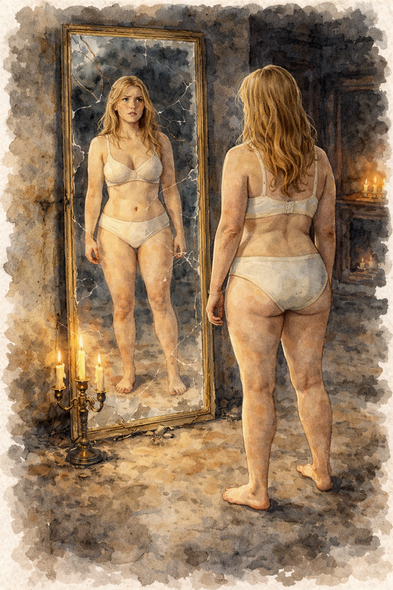

# Marie Alm – Akademikern

*Rollperson · 28 år · Arbetsutkast*

## Vem hon är

Maries familj omkom i en frontalkrock med en timmerlastbil. Hon växte därefter upp ensam med sin mormor, [Astrid Örn](astrid-orn.md), på Östermalm i Stockholm. Hennes brinnande intresse för det förflutna fick henne att läsa historia och arkeologi. Hon siktar på en akademisk karriär som museiintendent, arkivarie, arkeolog eller något liknande – och om allt går åt skogen, historielärare. Innan hon flyttade in gjorde hon slut med sin pojkvän.

Hon hade A i alla kurser på gymnasiet och högsta betyg på samtliga universitetskurser. Hon är perfektionist och lägger all sin energi på att lösa varje uppgift så bra som möjligt. Kanske är det därför hon saknar en stor bekantskapskrets.

Hon anslöt sig till [kulten](../kanon/kulten.md) för att förstå lertavlorna och har sett luckor i Abrahamssons tolkningar.

## Professorns student

Marie var Abrahamssons mest begåvade student och hans tidigare älskarinna. Det är ungefär ett år sedan de slutade. Hon har aldrig känt något på riktigt för honom, men han är fortfarande förälskad i henne.

När professorn skulle till utgrävningarna vid Döda havet fick han ta med en student, och konkurrensen mellan eleverna var hård. Marie visste att hon var bäst. Men hon såg hur en klasskamrat flörtade med professorn för att säkra sin plats, och gjorde likadant. Det slutade med att de åkte som ett par: den äldre mannen med den unga kvinnan vid sin sida.

Offentligt är det Abrahamsson som gjort fynden. Sanningen är att hon gjorde de största upptäckterna, och han tog äran.

> **Spelledarhemlighet:** I källarutrymmet de hittade på utgrävningen kände hon som om hennes själ fick kontakt med forntiden. Det var inte första gången hon stod där.
>
> Hon och Peter blev ett par under planeringen.
>
> Hon har lämnat professorn men inte kulten, eftersom hon tror att den är på spåren av något. Tillsammans med [Peter](peter-keller.md) började hon lista ut hur en riktig ritual skulle se ut. De ogillade Abrahamsson och ville inte ta med honom. [Rebecca](rebecca-rosenberg.md) passade deras planer, eftersom pengar alltid är bra. [Alexander](alexander-ehrson.md) blev den sista i gruppen. Han verkade villig och ivrig, och ritualen behövde fyra personer.
>
> De började hinta för professorn om att den sanna ritualen kräver ett blodsoffer. Han svarade genom att låta [Jelena](jelena.md) rekrytera [Viktor](viktor.md) och [Ellen](ellen.md), ett knarkarpar. Han menade blod. Marie och Rebecca tog det till döden och började ta till sig Ellen för att ha henne som offer. Se [sanningen](../kanon/sanningen.md#planen-som-verkligen-gällde).

Professorn är i hemlighet förälskad i henne. **Brevet** är förfalskat till en kärleksförklaring till honom – allt utom sista stycket (se [breven](../spelverktyg/breven.md#marie-alm)). Hon har aldrig känt något på riktigt för honom, se [M13](../arbete/motsagelser.md#m13-maries-brev-och-kanslorna).

## Kläder i klädhögen

*Akademisk minimalism:* grön fjällrävenanorack, mörk stickad tröja och ljus skjorta. Raka byxor och enkla läderkängor. Mobil och husnyckel.

## Rummet i Templet

Rörigt, med kläder i högar på stolar. Klädstilen är enkel och funktionell, i dämpade färger. En bärbar dator ligger i sängen med laddaren i vägguttaget (kräver lösenord). Hyllorna ovanför skrivbordet är fulla av böcker om arkeologi och historia, med överstrykningar och täta, källkritiska marginalanteckningar med hänvisningar till andra verk. När hon bläddrar i böckerna märker hon att hon behärskar ämnena väl – **ge henne fördelen Expert**. Garderoben är nästan tom.

## Bakom skärmen

**Passiva attribut:** Tålighet +0, Viljestyrka +2, Reaktion +0
**Aktiva attribut:** Intellekt +3, Intuition +1, Sinnen +0, Kyla −1, Hårdhet −2, Utstrålning +2, Själ +1

### Fördel: Expert
Du är expert inom historia och arkeologi. Dina kunskaper finns kvar trots minnesförlusten och gör sig påminda när de är relevanta. När du **undersöker** något kopplat till dina ämnesområden får du alltid ställa en extra fråga, oavsett utfall, och du är inte begränsad till frågelistan.

### Fördel: Hjälplös
När du ser ut att vara försvarslös och befinner dig i en farlig eller utsatt situation, **slå +Utstrålning**:

- **(15+)** Ta två övertag.
- **(10–14)** Ta ett övertag.
- **(−9)** Någon försöker utnyttja dig. Spelledaren gör ett drag.

Du kan spendera dina övertag under scenen för att:
- få någon att ta hand om dig eller skydda dig.
- få en aggressiv person att avstå från att skada dig.

## Trådar

- [Identitetsmysteriet](../tradar/identitetsmysteriet.md): det förfalskade kärleksbrevet.
- [Abrahamsson och Marie](../tradar/abrahamsson-och-marie.md): professorns försök att göra henne till sin älskarinna.
- Ledtrådar om kultens villfarelse: Maries marginalanteckningar, se [ledtrådar](../spelverktyg/ledtradar.md).
