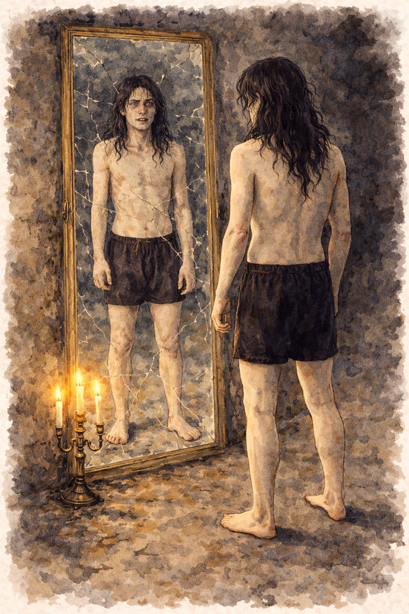

# Peter Keller – Ockultisten

*Rollperson · 28 år · Arbetsutkast*

## Vem han är

Peter har sitt sociala liv på nätet, där han är känd under aliaset **Obsidian8** och har vänner över hela världen. I det fysiska livet är han tillbakadragen och blyg. Han lever på studiemedel och läser enstaka kurser utan tydlig plan för framtiden.

När han var liten försvann hans bästa kompis under oklara omständigheter. Peter såg tecken på att något övernaturligt låg bakom, men polisen hävdade motsatsen trots att de saknade bevis och lade till slut ner fallet. Det fick honom att söka svar bortom de etablerade förklaringarna. Med tiden drogs han till gothkulturen och dess fascination för det ockulta. Med The Sisters of Mercy som idoler har han länge fördjupat sig i mörkare tankevärldar. Mörkklädd, lång och smal påminner han om bandets sångare Andrew Eldritch.

Intresset för det ockulta förde honom till [kulten](../kanon/kulten.md) – för svar och gemenskap – men han ifrågasätter Abrahamssons kunnande. Professorn är imponerad av Peters kunskaper om det ockulta.

**Brevet** är helt förfalskat (se [breven](../spelverktyg/breven.md#peter-keller)): det säger att han lagt nätlivet bakom sig och litar på professorn. I verkligheten skrev han tvärtom.

## Kläder i klädhögen

*Rockminimalism:* svarta jeans, t-shirt, sneakers och skinnjacka. Mobil och husnyckel.

## Rummet i Templet

På ena väggen hänger en inramad affisch med The Sisters of Mercy. På skrivbordet står en stor gamingdator och framför den en matchande stol. Kläderna i garderoben går i svart. Ockulta böcker och anteckningar. Datorn är låst och kräver lösenord.

## Bakom skärmen

**Passiva attribut:** Tålighet +0, Viljestyrka +2, Reaktion +1
**Aktiva attribut:** Intellekt +2, Intuition −2, Sinnen +1, Kyla +1, Hårdhet +0, Utstrålning −1, Själ +3

### Fördel: Magisk intuition
Du har en förmåga att känna av magi och uppfatta övernaturliga fenomen som andra förtränger eller undermedvetet bortförklarar. När spelledaren bedömer att din magiska intuition reagerar, **slå +Själ**:

- **(15+)** Du uppfattar vad som är magiskt eller övernaturligt och kan koppla det till ockult kunskap du minns.
- **(10–14)** Du uppfattar vad som är magiskt eller övernaturligt men saknar kunskap om vad det är.
- **(−9)** Du uppfattar något som inte stämmer, men misstolkar det eller drar fel slutsats – eller så märker du inget alls. Spelledaren kan göra ett drag.

## Trådar

- [Identitetsmysteriet](../tradar/identitetsmysteriet.md): det förfalskade brevet.

> **Förslag:** Barndomsvännen som försvann och kultens [försvunna före detta medlem](../kanon/kulten.md#obehagliga-inslag--maktens-vardag) är två lösa trådar som skulle kunna vara samma. Ej beslutat.

> **Förslag:** Obsidian8 har vänner över hela världen som märker när han tystnar. De kan vara den enda som saknar honom.
