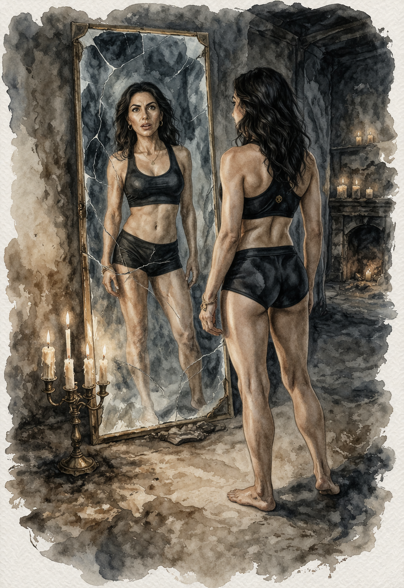

# Rebecca Rosenberg – Mångmiljonären

*Rollperson · knappt 40 år · Arbetsutkast*

## Vem hon är

Rebecca har arabiska drag men är judinna från USA. Som spädbarn flyttade hon med sina förmögna föräldrar till Sverige, där hennes far arbetade i ett större företag. Hon har svenska och engelska som modersmål. Efter gymnasiet återvände familjen till New York och hon började arbeta inom familjens verksamhet. I trettioårsåldern drabbades hon av en livskris som väckte hennes intresse för det judiska arvet. Ekonomiskt oberoende flyttade hon tillbaka till Sverige och började studera religionshistoria vid Stockholms universitet. Hon sökte sig till Abrahamsson av nyfikenhet på judisk mysticism och sanningen bakom de forntida berättelserna i Toran. 

I [kulten](../kanon/kulten.md) är hon huvudfinansiär och officiell andreman, men hennes inflytande är mest formellt. Hon har större rum, eget badrum och tillträde till bibliotek och ledningsmöten. [Jelena](jelena.md) har den verkliga operativa makten. Efter ritualen minns hon inte sin ställning.

**Brevet** (se [breven](../spelverktyg/breven.md#rebecca-rosenberg)): första stycket är sant – skilsmässan, New York, ingen hon känner i Stockholm. Det andra är förfalskat för att lägga skulden för ritualen på henne.

## Kläder i klädhögen

*Diskret lyx:* täckväst, mörk kashmirkofta, sidenblus och välskurna byxor. Dyra svarta sneakers. Mobil och husnyckel.

## Rummet i Templet

En större svit med eget badrum. Ombonad med rökelse, blommor, olika lampor och röda gardiner. Den bärbara datorn på skrivbordet är låst. Förutom kultens litteratur om forntiden finns en rad magasin om företagande, omvärldsanalyser, internationella kontakter och finansiella handlingar. Allt är på engelska, utom **en Tora på hebreiska vid sängen**. När hon öppnar den märker hon att hon kan läsa hebreiska. I garderoben hänger diskreta, lyxiga plagg i business casual.

## Bakom skärmen

**Passiva attribut:** Tålighet +1, Viljestyrka +1, Reaktion +1
**Aktiva attribut:** Intellekt +1, Intuition +2, Sinnen −2, Kyla +0, Hårdhet +1, Utstrålning +2, Själ +0

### Fördel: Naturlig ledare
När du kliver fram och tar kommandot, **slå +Utstrålning**:

- **(15+)** Personerna omkring dig accepterar dig som ledare och lyssnar på dig. Du har *+1 pågående* mot dem så länge de accepterar ditt ledarskap.
- **(10–14)** Personerna omkring dig lyssnar på dig. Du har *+1 på nästa slag* mot dem.
- **(−9)** Dina försök att ta kommandot väcker motstånd och förakt. Spelledaren gör ett drag.

## Trådar

- [Identitetsmysteriet](../tradar/identitetsmysteriet.md): brevet pekar ut henne som den som drev på ritualen.
