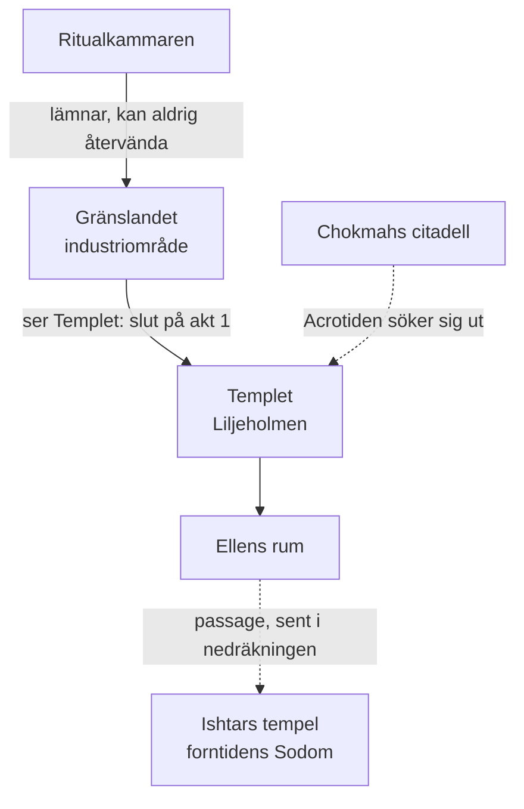

# Platser

| Plats | Typ | Var |
|---|---|---|
| [Templet](templet.md) (Bet Ishtar Templet) | Kultens hus | Liljeholmen, Stockholm |
| [Ellens rum](ellens-rum.md) | Rum i Templet | Centrum för det övernaturliga |
| [Gränslandet](granslandet.md) | Rike | Där akt 1 utspelar sig |
| [Ritualkammaren](ritualkammaren.md) | Rum | Gränslandet – går inte att hitta tillbaka till |
| [Chokmahs citadell](chokmahs-citadell.md) | Rike | Där Ellens själ nu sitter fången |
| [Ishtars tempel i Sodom](sodom-templet.md) | Tidsplats | Nås genom passagen i Ellens rum |

## Geografi

Det finns **ingen fysisk förbindelse** mellan Templet och ritualkammaren.
