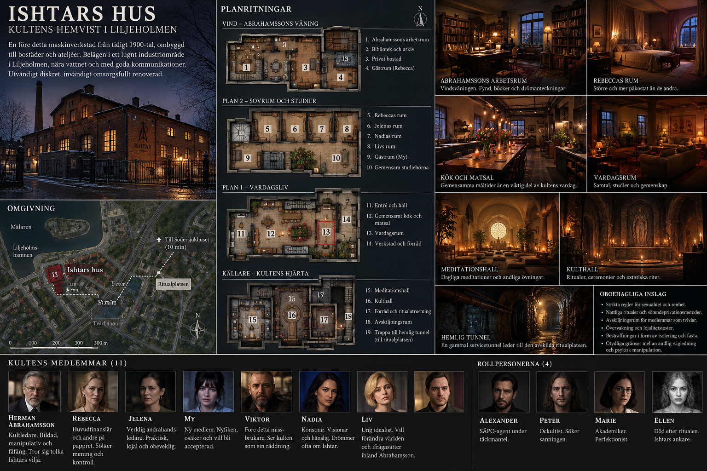

# Ishtars hus – kultens hemvist (Asyl)

**Status:** Föreslagen fiktiv fastighet i Liljeholmen, Stockholm. Exakt gata och byggnadsplan är ännu inte fastställda. **Asyl** är ett föreslaget namn, ännu inte slutligt.

En äldre maskinverkstad från omkring sekelskiftet 1900 har byggts om till kollektiv och religiöst centrum. Den ligger på en avskild, stenlagd gård bakom en järngrind och tegelmur, med äldre industrihus, verkstäder och modernare kvarter runtomkring. Den gamla verksamhetens namn kan fortfarande anas på tegelfasaden. Från utsidan är huset diskret; inuti är det ombonat, påkostat på vissa ställen och påfallande välordnat.

> ⚠ Konceptbilden är äldre: den visar en hemlig tunnel (finns inte), Ellen som rollperson och saknar rum för flera medlemmar. Se [bilder/README.md](../bilder/README.md).

## Omgivning och gård

En låst järngrind vetter mot en anonym sidogata. På gården finns kullersten, ett kastanjeträd, en övervuxen rabatt, ett litet förråd och en gammal lastport. Ljud från staden når hit som ett avlägset brus. Gården är tillräckligt privat för gemensamma kvällar, men den är ingen fästning: leveranser, grannar, polis och medlemmarnas egna kontakter kan nå fastigheten på vanliga sätt.

## Bottenvåning – kök, matsal och vardagsrum

**Entrén:** Tunga dörrar, anslagstavla, skohylla och en lista över veckans uppgifter. [Jelena](../personer/jelena.md) vet vilka som kommer och går. Här sitter ibland små påminnelser om reningsövningar och obligatoriska samlingar.

**Kök och matsal:** Ett välutrustat storkök med ett långt bord där alla kan äta tillsammans. Gemensamma middagar skapar värme och tillhörighet, men fungerar också som informella förhör: frånvaro, tvekan och konflikter noteras. Jelena organiserar inköp och arbetspass; Rebecca kan få särskilda önskemål uppfyllda.

**Vardagsrum:** Mjuka soffor, eldstad, böcker, filtar och en liten musikanläggning. Här samtalar, spelar och grälar medlemmarna. Den stora bilden av Ishtar är gjord efter Abrahamssons drömmar, utan att han själv inser hur exakt den föreställer den fångna kvinnan.

> **Notera:** "Den fångna kvinnan" var Ishtar när bilden målades. Nu sitter Ellen i citadellet. Förändras bilden? Se [oppna-fragor](../arbete/oppna-fragor.md).

## Övervåning – privata rum

Här finns små sovrum och delade badrum. Rollpersonernas rum behåller sina identitetsledtrådar från originalet: Alexanders krypterade utrustning, Peters dator och ockulta material, Maries anteckningar och Rebeccas hebreiska texter och ekonomiska handlingar. **Rebecca har en större svit med eget badrum**, en konkret förmån som finansieringen gett henne. De övriga medlemmarnas rum speglar deras personligheter.

[Ellens rum](ellens-rum.md) har en egen fil.

> **Lucka:** Rumsfördelningen är inte bestämd. Var ligger Ellens rum?

## Vindsvåning – bibliotek och Abrahamssons privata rum

**Biblioteket:** Bokhyllor från golv till tak, arkeologiska rapporter, fotografier av lertavlor, handskrivna översättningar och ockult litteratur av skiftande kvalitet. Här hålls studiecirklar och möten. Rebecca har särskild tillgång, men Jelena avgör i praktiken när Abrahamsson får störas.

**Arbetsrummet:** Låst, belamrat med anteckningar, drömjournaler och skisser av en svart katedral och en fången kvinna. Här finns också spår efter manipulationen av de förseglade självporträtten.

**Abrahamssons bostad:** Bekväm och avskild. Kontrasten mot de enklare medlemsrummen understryker maktförhållandet.

## Källaren – meditation och kult

**Meditationshallen:** Ett stort, ljust rum med kuddar, mattor, växter och ett runt fönster eller ljusschakt. Här leds andningsövningar, tysta sittningar och drömberättelser. Atmosfären kan vara verkligt rogivande.

**Kulthallen:** Ett mörkare rum med tegelvalv, ljus, rökelse, ett stenaltare och en monumental avbildning av Ishtar. Här hålls invigningar, gemensamma böner och ceremonier. Rummet är skrämmande först när man förstår hur bekännelser och lojalitetskrav används.

**Förråd och arkiv:** Ritualrekvisita, gamla mötesprotokoll, reningsscheman och medlemmarnas inlämnade texter. Vissa skåp är låsta. **Ingen passage leder till ritualplatsen.**
