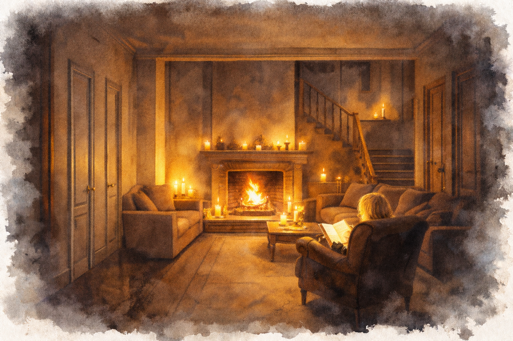

# My vid brasan

## Utlösare
Rollpersonerna kommer in i [Templet](../platser/templet.md). Om de inte kommer mitt i natten möter de My först.

## Förlopp
[My](../personer/my.md) sitter uppkrupen i en fåtölj framför brasan i vardagsrummet och läser en bok. Ett tiotal doftljus i olika storlekar lyser upp rummet.

Hon flyttade in för en vecka sedan och har inte lärt sig allas namn. Hon har ingen aning om vad som hänt. Hon vill gärna passa in och bli en del av gruppen som verkar stå varandra så nära.

## Ledtrådar som kan dyka upp
- Hon kan märka att någon har fel kläder på sig.
- Hon hörde dem repetera fraser på ett främmande språk innan de gav sig av, och diskutera vem som skulle ge blod till ockran.
- Hon vet inte riktigt vem som bor i vilket rum.

## Hur scenen för trådarna framåt
[Identitetsmysteriet](../tradar/identitetsmysteriet.md): det första mötet med någon som kände dem – nästan.
